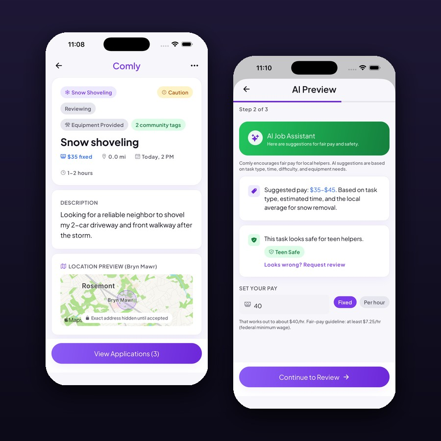
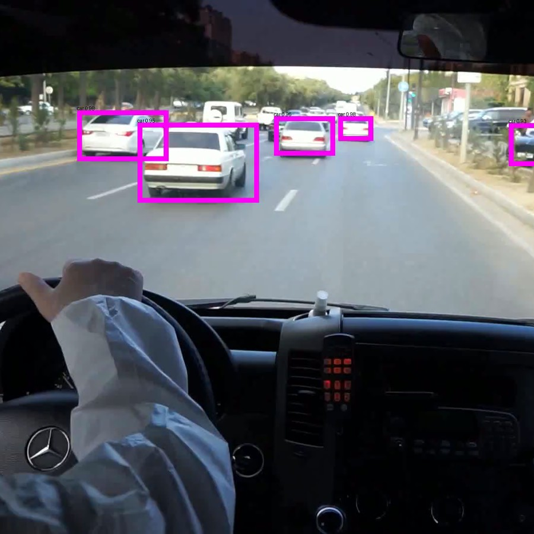
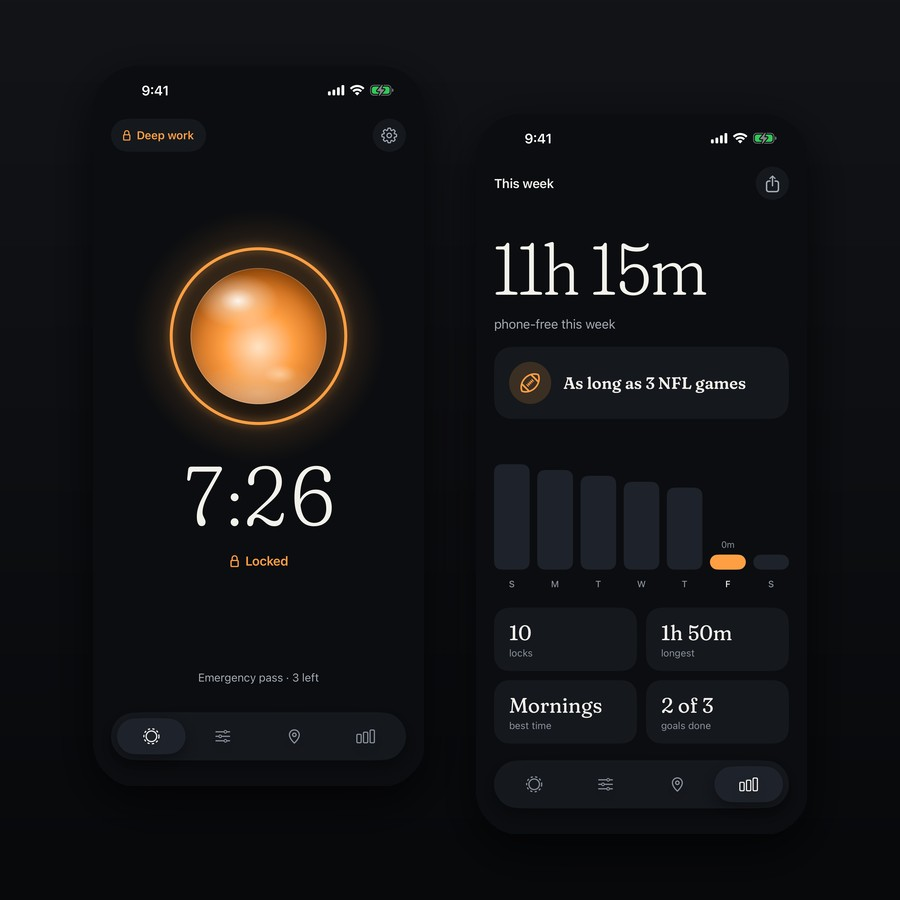
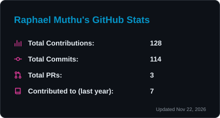
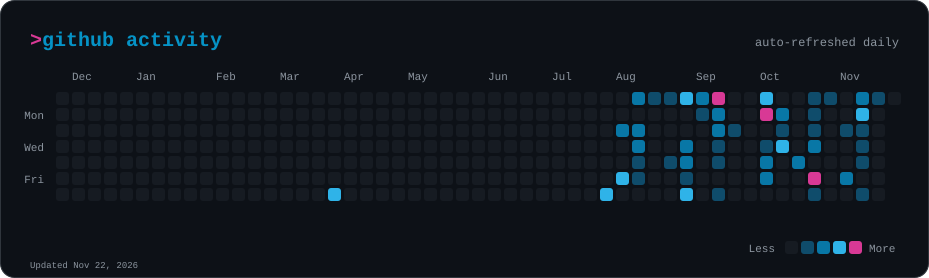

  

<h1 align="center">Raphael Muthu</h1>

  <b>Embedded & Applied AI &nbsp;&middot;&nbsp; Hardware Systems &nbsp;&middot;&nbsp; Quantum Computing</b>

  📍Philadelphia
  &nbsp;&nbsp;|&nbsp;&nbsp;
  <a href="mailto:raphaelmuthu21@gmail.com">raphaelmuthu21@gmail.com</a>

 

## Get to know me!

Hi! I'm Raphy, a 10th grade student based in the Philadelphia area. I build professional and interactive UI/UX to properly showcase intricate and novel backend systems. Additionally, I build hardware systems using many different microcontrollers, firmware, and sensors.

My focus work sits where AI models, firmware, sensors, and analytics meet: getting a physical device to obtain data or sense its surroundings, process the data/what it sees, and act on it reliably in the real world.

Additionally, I'm very interested in **quantum computing**. Currently, I am exploring Variational Quantum Eigensolver (VQE) and Quantum Approximate Optimization Algorithm (QAOA) optimization. The process of how these circuits get compiled onto real hardware using qubit routing and transpilation is fascinating to me, and I’m learning to build and simulate my own quantum circuits with Qiskit. I would be thrilled to have the opportunity to learn about and research this further!

 

##  Project Spotlight

<table>
  <tr>
    <td width="33%" valign="top" align="center">
      
    </td>
    <td width="33%" valign="top" align="center">
      
    </td>
    <td width="33%" valign="top" align="center">
      
    </td>
  </tr>
  <tr>
    <td valign="top">
      <h3><a href="https://github.com/raphy-muthu/Comly-App">Comly</a></h3>
      
An app where community members can post listings for small, local jobs. Tailored towards helping teens find jobs, we implemented many safeguards & teen safety tiers. Contact details for both parties unlock only after a request is accepted, and an AI assistant suggests fair pay and analyzes the job listing for potential danger.

      
      
      
      
    </td>
    <td valign="top">
      <h3><a href="https://github.com/raphy-muthu/yolo-autonomous-object-detection">Autonomous Object Detection</a></h3>
      
Convolutional Neural Network with Supervised Deep Learning that takes an image or video and returns it with labeled bounding boxes around each detected object. Trained on data to create Self-Driving Car Detection Systems, this model is the perception layer for an autonomous system.

      
      
      
      
      
      
    </td>
    <td valign="top">
      <h3><a href="https://github.com/raphy-muthu/Tapout">Tapout</a></h3>
      
A physical NFC key for phone focus. Tapping a paired tag locks distracting apps through Apple's Screen Time APIs. The companion app is designed in an interactive and informative way, so that the user can effectively track their progress and make necessary adjustments. At only $5, it is cheaper than any other competing products.

      
      
      
      
    </td>
  </tr>
</table>

 

## Experience/Skills

### Languages

  
  
  
  
  
  
  
  
  
  

### Hardware, Embedded AI & Quantum

  
  
  
  
  
  
  
  
  

### Apps & Backends

  
  
  
  
  
  
  
  
  

### Tools

  
  
  
  
  
  
  

 

## Activity
<!-- These cards are generated by scripts/generate_stats.py and refreshed daily by .github/workflows/update-stats.yml -->

  

  

